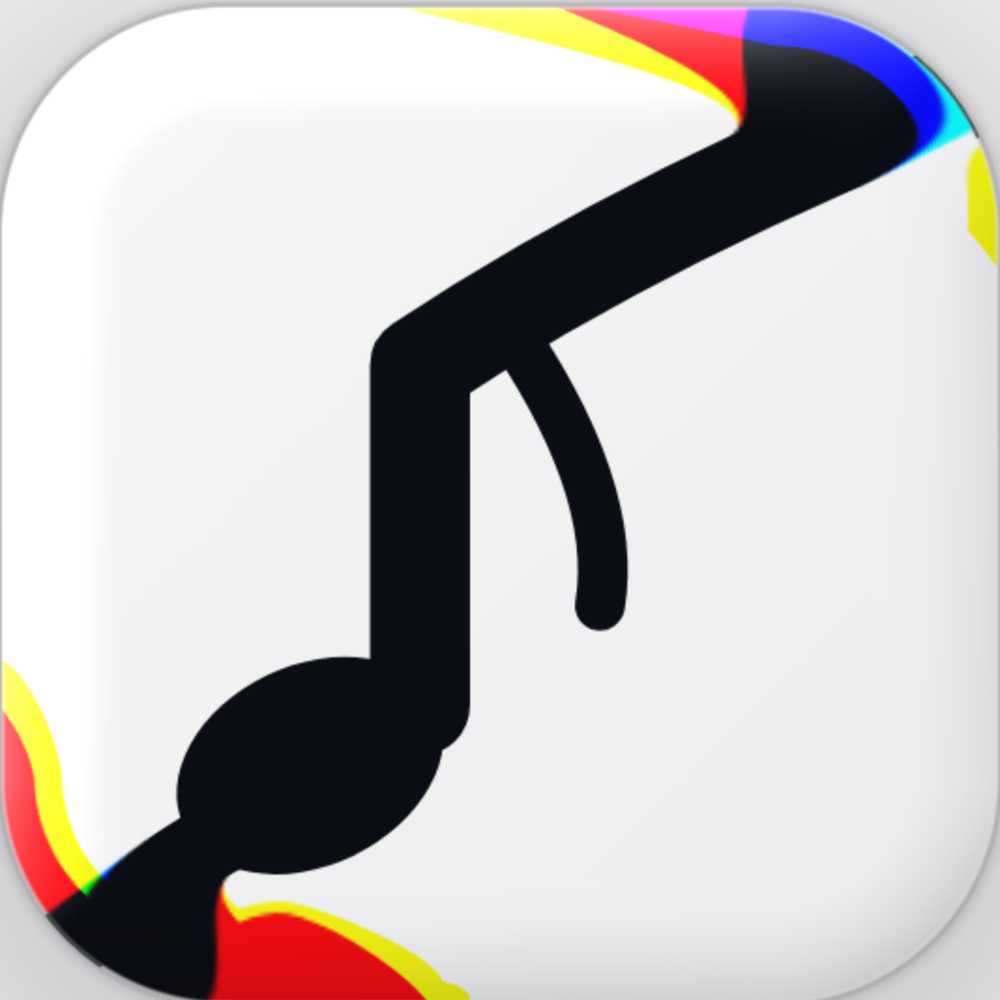

**Fady. The Only Sherlock House!**

# GlassLookStore changelog

Versions are X.Y.Z (X has no limit, Y and Z go to 9 and roll over). Tags: ✨ New · 🛠 Fix · ⚡ Speed · 🧪 Test.

## 0.1.0 · 2026-11-05 18:00 UTC · The first glass

Written and pushed; **not built yet** (the Codemagic build waits for the owner's typed Go). Never compiled.

### Changes

- ✨ **Tab bar like Walmart (IMG6, IMG7).** A floating capsule 62 pt tall, 20 pt side insets, 8 pt above the home indicator, built with GlassEffectContainer. Grey pill at rest, 4.3 pt inside each end of the bar, 7.5 pt wider than the tab spacing, so every tab sits in the middle of its pill (preview build 16). Check `bar.layout`. Files: `Components/GlassTabBar.swift`.
- ✨ **Drag lens.** Touch the bar and the pill swells into a clear glass lens 1.3 tabs wide and 71.5 pt tall that spills above and below the bar, magnifies the tabs 1.4x, shows IMG1 colour rims, follows the finger, stretches up to 8 % with speed and springs to the nearest tab on release (response 0.35, damping 0.7), then shrinks into the grey pill as its glass fades (preview build 12). The bar grows 3.5 % while pressed. Switch "Glass bubble at rest" (Off) keeps the bubble. Check `bar.lens`. Files: `Components/GlassTabBar.swift`, `Components/GlassLensDroplet.swift`.
- ✨ **Mirrored labels (IMG3).** Each tab label is mirrored, faded, in the bottom bevel. Switch "Mirrored tab labels" (On).
- ✨ **Hero counter (IMG2, IMG5).** Session timer HH:MM in SF Pro ultraLight condensed (owner's pick), scaling down with Dynamic Type; date, project and status above; battery-style usage bar bottom left; your signature bottom right (tap to edit). The LiquidWave shader bends the numerals and the moving light, looping every 10 s. Check `hero.clock`. Files: `Components/HeroCounterCard.swift`, `Components/UsageBar.swift`, `Shaders/LiquidWave.metal`.
- ✨ **Live tiles and sparkline.** Tokens today, limit reset countdown, commits, lines added and removed, last build (green or red dot and time), streak; a 7 day sparkline with area, line and the last point emphasised. Numbers roll with `.numericText()`. Check `provider.mock`. Files: `Views/LiveView.swift`, `Components/StatTile.swift`, `Components/SparklineCard.swift`.
- ✨ **Card style A, straight edges (owner's pick, preview builds 13 to 15).** Native Liquid Glass frosted by AI glass, the moving light inside, a thick clear bevel and the IMG1 rim from the GlassLens shader. Text sits above the glass and is never frosted. Switch "Waving card edges" (Off). Check `card.glass`. Files: `Components/GlassCard.swift`, `Shaders/GlassLens.metal`.
- ✨ **🤖 AI glass.** Apple AI on the iPhone (Foundation Models, structured answer) decides frost, blur, tint and the moving light's colours; the iPhone reading is used only until or unless it answers. Settings shows who decided. Check `ai.glass`. File: `Theme/GlassTheme.swift`.
- ✨ **Projects, Stats, Logs.** Project glass cards with version and progress ring; weekly bars and a 30 day line in Swift Charts; a monospaced log timeline with swipe to delete, saved on the iPhone only. Files: `Views/ProjectsView.swift`, `Views/StatsView.swift`, `Views/LogsView.swift`.
- ✨ **Data sources.** `CounterProvider` protocol; `MockProvider` (default, moves every second), `ManualProvider` (SwiftData, editor with − and + on the slider), `GitHubProvider` (commits and lines today through the REST API; token in the Keychain with a 🧪 Test key and ⚪ 🟢 🔴 status). Updates run on the main actor every second and pause in the background. Check `provider.manual`. Files: `Data/`.
- ✨ **Widgets.** Home Screen small and medium, Lock Screen circular, rectangular and inline, Live Activity on the Lock Screen and in the Dynamic Island (updated once a minute, switch in Settings). Check `widget.snapshot`. Files: `Widgets/`.
- ✨ **Icon packs (owner: "we still keep the icons pack").** The 17 free libraries of Supplies 221B for the five tab icons (74 images copied), SF Symbols by default, preview and credit in Settings › Icon pack; a missing icon falls back to SF Symbols. Check `icons.packs`.
- ✨ **Haptics.** Selection tick when the lens crosses a tab, light on release, soft on a tap, rigid when usage passes 80 %; all off with the Haptics switch. Check `haptics`. File: `Theme/Haptics.swift`.
- ✨ **Dark mode.** Every colour is an asset colour set with light and dark values; dark uses the navy to red gradient (IMG5), clearer glass, stronger fringes and a soft glow on white text. Check `theme.colors`.
- 🧪 **Built-in 🧪 Test** on the Live screen and in Settings: 17 dry-run checks with a progress bar, a 3 s limit per check, ✅ Passed / ❌ Failed / ⛔ Stopped, the last 50 log lines and 📋 Copy for Claude (summary, Behind the scenes, FOR CLAUDE JSON). The check `updates.checks` refuses a ✨ change without a check. File: `Views/SelfTestView.swift`.
- 🧪 **UI tests on Codemagic:** screenshots of every tab in light and dark, slow drag, fast flick past the edge, drag past the left edge, tap, the 🧪 Test must pass, version shown in Settings. File: `GlassLookStoreUITests/GlassLookStoreUITests.swift`.
- ✨ **App icon** in the IMG1 music-icon glass, light and dark, rendered from the approved preview.

### Behind the scenes

- **Built from:** the approved web preview (https://claude.ai/artifact/YYRHfq8g6HoFmsPnnkuZ4x, build 16) and the owner's answers: bar like Walmart, centred landing, grey pill at rest, cards A with straight edges and moving light, Apple AI for colours, frost and blur, icon packs kept, version 0.1.0, files in `GlassLookStore/` on `main`.
- **Lessons from the preview carried over:** the lens lands on centres measured on the bar at rest, never on the pressed (3.5 % bigger) bar (build 10); frost never blurs the card's own text (build 14); end pills stay inside the bar (build 16).
- **Codemagic:** new workflow `glasslookstore-ipa` on the existing Supplies Codemagic app; simulator tests are ad-hoc signed so the Keychain works there.
- **Proven:** nothing on a device or compiler yet. The web preview proved the layout math and the shader look.
- **Not proven / known limits:** the page behind the lens is not magnified (only the tabs are; the native glass refracts the page); the hero numeral uses SF Pro ultraLight condensed, a little less tall than IMG5; Apple AI needs an iPhone with Apple Intelligence; the first Codemagic run may need compile fixes (Swift 6 strict concurrency, iOS 26 APIs).
