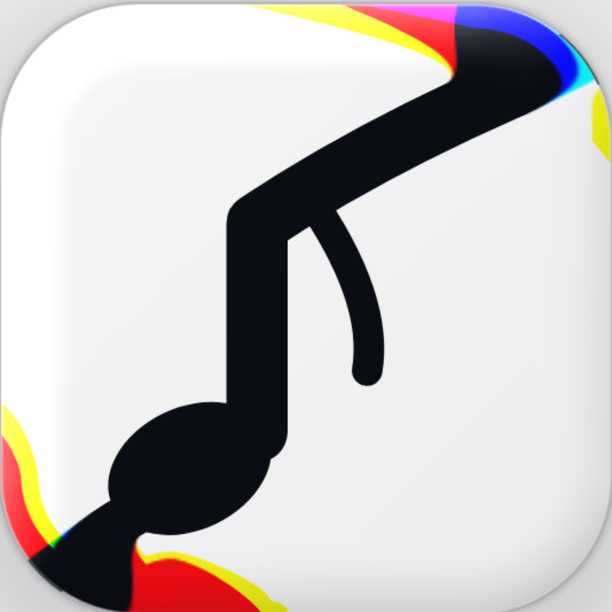

**Fady. The Only Sherlock House!**

# CLAUDE.md: GlassLookStore 221B

Native SwiftUI app for iOS 26 (Swift 6, XcodeGen `project.yml`): a live counter dashboard for coding in the Liquid Glass look of IMG1 to IMG7. See `README.md`, `CHANGELOG.md`, `DEBUGLOG.md`. Version in `project.yml` (`MARKETING_VERSION`, `CURRENT_PROJECT_VERSION`).

## Project rules (win over the shared rules where they conflict, rule 8.6)

1. **Public repo, on purpose** (owner, 2026-11-05: free GitHub Mac builds like Codemagic): never commit personal data, keys or tokens; the GitHub token lives only in the iPhone's Keychain.
2. **Build:** GitHub Actions workflow `.github/workflows/glasslookstore-ipa.yml` (macos-15, newest Xcode 26, Metal Toolchain, unsigned Release, UI tests with light and dark screenshots, crash reports, ad-hoc App Group signing, `.ipa` artifact). A push starts nothing: Claude runs it with workflow_dispatch only after the owner types **Go** (rule 14.59). Codemagic (`glasslookstore-ipa` in CPAP-Supplies-Log-221B) is the second route when its billing is on.
3. **Native Swift, not Expo Go** (like Sherlock and Supplies): delivery is the `.ipa` (rule 7.1).
4. **Look:** every look change gets a preview page first (rule 14.63). Approved preview: https://claude.ai/artifact/YYRHfq8g6HoFmsPnnkuZ4x (build 16). Bar = Walmart (`BarLayout`), cards = style A straight edges + moving light, Apple AI decides colours, frost and blur, icon packs kept.
5. **Versioning:** X.Y.Z (rule 4); every version bumps `project.yml`, the in-app Updates Log (`UpdatesLog.versions`), README and a dated CHANGELOG entry.
6. **🧪 Test:** every ✨ New feature registers a check in `FeatureChecks.all` (Views/SelfTestView.swift); the check `updates.checks` and the UI test `testBuiltInSelfTestPasses` refuse a build without one.
7. **File names:** PascalCase, no underscores (rule 5.1); ask the owner before naming a new file (rule 5.2).

## Status

**0.1.0 (build 1): BUILT AND DELIVERED 2026-11-05 ~20:45 UTC** (Codemagic 6aece8d6aabd167368bcb247 on the owner's new Codemagic account, app 6aece8c0d7c030383018211c; 0 warnings, 5/5 UI tests, 🧪 17/17). Next: owner installs, runs 🧪 Test, pastes 📋 Copy for Claude; regenerate the Codemagic key pasted in chat; owner makes this repo private (owner: "Make it private after I created a new code magic account"). Before: **0.1.0 written, not delivered.** Owner typed Go on 2026-11-05. Codemagic runs 1 to 4 (compiled first time, 0 warnings, 4 of 5 UI tests) then billing ran out; GitHub on the private Supplies repo got no Mac. Moved here (public) the same day. Open: the app closed during the 🧪 Test in Codemagic run 4 (likely `ManualProvider` released its SwiftData container; fixed, not proven). The code also stays in CPAP-Supplies-Log-221B `GlassLookStore/` (not deleted, rule 3.10).

---

## Shared rules (short)

> **Grouped by topic** (owner, 2026-11-04: "the rules that related together … after each other"): each rule keeps its own number; related rules sit next to each other, so one block holds a whole topic.
> **One rule per number, the same numbers as the full rules** (owner, 2026-11-04: "keep the same number of rules, and each number gets one rule"). Each line is a short version of that rule with every part of it kept. Full wording, the owner's quotes and the history: [Readme-Updates README](https://github.com/farahotaelgn/Readme-Updates/blob/main/README.md) (open it only when a rule needs more detail). **[All]** = every app · a project tag = that project only · **this project's own rules win** where they conflict (rule 8.6).
> **Scriptable is retired** (owner, 2026-11-04: "I will never use scriptable again"): every Scriptable rule and every rule marked *(on hold)* is kept for the record only and never followed. Expo Go is the default for new apps; native Swift apps (Sherlock, Supplies) follow their own CLAUDE.md where it says so.

### 💬 Talking with the owner
- 1.6 [All] Give ready-to-use fixes; don't ask the owner to check things.
- 1.7 [All] When coding or building apps, say how much usage is left.
- 1.9 [All] When the owner must do something: no checklists · a yellow frame `# **🟡🟡🟡 YOUR TURN 🟡🟡🟡**` · the place on the next line · numbered 🟡 steps, one action each · say if a Shortcut is a regular shortcut or an automation, and whether to stay in it or save and start a new one · never a Terminal command.
- 1.10 [All] Every reply line fits one iPhone chat line; rows of squares at most 8; long items (IDs) on their own line.
- 2.1 [All] Anything vague or incomplete: ask before acting.
- 2.2 [All] Ask with interactive (selectable) questions, never plain text to type out.
- 2.3 [All] Write every question and option in full, never cut with "…".
- 2.4 [All] Make no decision alone; every design, logic or scope choice is a question to the owner.
- 2.6 [Converter] Questions are Yes/No only, each with what Yes and No mean; few, only when blocked.
- 2.7 [Supplies] Before new tasks, surface any unfinished plan or pending decision from last session.
- 2.8 [All] Every choice has Claude's recommendation (marked "(Recommended)", first) with why, plus why / why not for every option; the owner still decides.
- 9.14 [All] Once per chat, at the start, name in one line the loaded connectors the task doesn't need and where to turn them off.

### 🚦 Before any code: questions, plan, Go
- 3.1 [All] Ask clarifying questions first.
- 3.2 [All] Then show the full plan.
- 3.3 [All] The owner approves the plan (a picked option is fine) before Claude edits or pushes anything (version header too); scoping answers alone are not approval; everything except Go may be picked, only a build needs the typed Go (14.59) (owner, 2026-11-04: "Plan is fine do it but never buil unless I type go", "Everything except go I have to type it"); the request is framed `# **🔵🔵🔵 SAY GO 🔵🔵🔵**` with what it builds on the next line. Exception: "add new rule" (rule 9.7). For builds see rule 14.59.
- 14.59 [All] No build (Codemagic, EAS, any compiler run) and no version bump for one until the owner **types** "Go" for that work; a picked option never counts, even one labelled "Go", and Go is never offered as a choice; one Go covers one build round.
- 3.4 [All] The owner decides what the next version is and holds.
- 3.5 [All] Never ship guesses: find the real cause (logs, debug data) or ask, then plan, then get approval.
- 3.6 [All] Everything approved goes in one version; Claude never splits a request by itself; if too big, ask first, and it stays one version until answered.
- 3.7 [Supplies] Phases: design + approval → plan written in CLAUDE.md Section 5 and pushed → build, version, changelog, validate, push.
- 3.8 [All] Look deep first: read all code involved and its callers · prove the real cause · check real platform behaviour (say what can't be checked) · map every screen, file and setting touched and past lessons · write down the risks · no experiments on the owner's phone · say what is and isn't proven. Cheap testing only: Claude runs only syntax/build checks, `expo install --check`, `expo export`, `expo-doctor` and quick unit tests; no stand-ins, crawls or screenshots (kept on hold); the owner's 🧪 Test is unchanged.
- 3.9 [All] Never remove a feature; only add, blend and merge (a redesign keeps every option; conflicts become a setting); compare with the last version before delivery and put back anything lost; only the owner removes. Settings at most 3 levels; duplicates fold into one.
- 3.10 [All] Ask before deleting anything (file, code, feature, setting, rule wording, log, repo, branch, update, data) with a Delete / Keep question and a recommendation; not needed when the owner named that exact thing (today: older Expo updates after a good publish, owner data on GitHub once safe in iCloud). Rewriting code that keeps its behaviour and Claude's own temp files are not deletions.
- 14.50 [All] No dead controls: every switch, slider and picker changes something; the 3.9 check lists any that stopped working.

### 🔢 Versions and logs
- 4.1 [All] Format X.Y.Z: X no maximum, Y 0–9, Z 0–9.
- 4.2 [All] Small update (fix, tweak) → Z+1; big update (feature, redesign) → Y+1, Z=0; counting (rules 4.7.3): 1–3 fixes in one area = small, 2+ areas or 4+ fixes = big.
- 4.3 [All] Rollover: Z 9 → Y+1, Z 0; Y 9 → X+1, Y 0, Z 0 (1.9.9 small → 2.0.0).
- 4.4 [All] Every version bumps the version header and adds a changelog entry together; file/app names carrying the version are updated.
- 4.5 [Supplies] Each changelog entry has date and time.
- 4.6 [All] Version line, in-app Updates Log (13.3) and CHANGELOG.md always match.
- 4.7 [Converter] At most 5 new versions per chat; [Supplies] at most 10 per session; owner uploads don't count.
- 4.8 [All] Count up from the newest published version (GitHub `main`, Expo), never the chat's own; recheck before push; never reuse a number; read other chats' handoff before each request and renumber if they shipped first.
- 4.9 [All] Very detailed CHANGELOG.md: every change tagged (✨ 🛠 ⚡ 🧪) + Behind the scenes (cause, files, tests, proven / not proven); the in-app log may stay short.
- 8.9 [All] Every repo keeps DEBUGLOG.md: each error with date/version, what failed, real cause and proof, fix (files, lines), test, rating (/10, proof level, confidence %), status; written in the same push as the fix.
- 13.3 [All] Settings → 📜 Updates Log ("Fady Updates Log", that name never shown in an app): one row in Settings · versions newest first under day headers with tag counts, 🆕, ⏳ / ✅, filter chips · each version opens a page with every change, Behind the scenes, ✅ Works / ❌ Something's wrong · an "Updated to X" card after an update · matches CHANGELOG; Copy for Claude carries the last 5 Behind-the-scenes notes.
- 14.7 [Sherlock] Each version bumps `MARKETING_VERSION` and `CURRENT_PROJECT_VERSION`, the README version / `.ipa` name, and a dated CHANGELOG entry with a Sherlock Holmes-style title.
- 14.10 [Sherlock] In-app Updates log is simple (tagged changes, ✅ Works / ❌); full detail only in CHANGELOG and DEBUGLOG.

### 📄 File names
- 5.1 [All] Never use underscores (`_`).
- 5.2 [All] Ask the owner how to name every new file.
- 5.3 [All] The project description file is always `README.md`.
- 5.4 [Converter, Supplies] Spaces, version first (`vX.Y.Z … App.js`); [Supplies] later `Supplies 221B.js` with no version (on hold); Expo Go apps live in a folder named after the app, version in app.json / package.json / CHANGELOG.
- 5.5 [Supplies] `catalog-wheel.html` keeps its exact name.
- 5.6 [ClipVault] Keep the existing file names (`ClipVault.js`, `ClipVault-*.md`).
- 14.8 [Sherlock] PascalCase Swift file names, no underscores; the owner names every new file.

### 🛠 Building and testing
- 6.5 [All] Every new app is an Expo Go iOS app with real Liquid Glass; Scriptable on hold; only libraries "Included in Expo Go"; checked with `expo install --check`, `expo-doctor`, `expo export`; Claude publishes to Expo itself; after a good publish older updates on that branch are deleted. Exception: RPhs (6.6).
- 14.1 [Sherlock] Native Swift, not Expo Go; the delivery is the `.ipa`, Expo publishing rules don't apply.
- 14.2 [Sherlock] Build on Codemagic (app `6ae615c0f74dd458c708caa0`, workflow `sherlock-sleep-ipa`); a push starts nothing; Claude starts the build on `main` (only after Go, rule 14.59).
- 14.3 [Sherlock] Codemagic is the compiler: push, build, read `test.log`, download and send the `.ipa`.
- 14.4 [Sherlock] Codemagic reads the repo with its own read-only deploy key; never commit a key.
- 6.1 [All] Scriptable: validate with `node --check` only, never run on desktop (on hold).
- 6.2 [All] No auto-launch / auto-run in output files, never auto-open a delivered file; never give the owner a Terminal command or script; Claude runs every command.
- 6.3 [ClipVault] Run `node --test ClipVault/Scriptable/Tests/ClipVault-*.mjs` (on hold; ClipVault 221B runs its own tests).
- 6.4 [All] Every app has a built-in 🧪 Test (main screen + Settings): checks Liquid Glass, accessibility fallbacks, haptics, every feature, setting, Shortcut and automation · no taps, no devices (dry runs) · progress bar with % and current check · time limit per check (⏱), never stuck · always a report (✅ Passed / ❌ Failed / ⛔ Stopped) · 📋 Copy for Claude (summary + FOR CLAUDE JSON) · crash-safe, data restored · short output (passed = one count line, log last 50 lines + errors, nothing skipped) · speed steps (screen ≤ 0.5 s, tap ≤ 0.1 s, best of 3, a miss is ❌) · every new feature registers its check and the build refuses a ✨ New feature without one · every ⏱ is an error fixed at its cause · the test never closes the app.
- 14.6 [Sherlock] Every new parser or importer gets a self-test case and a unit test; the case count is checked.
- 14.17 [Sherlock] No extra tap gesture on a row or button that opens a page; haptic on the opened page or in the action; the unit test refuses the build.
- 6.6 [RPhs] An Excel workbook (xlsx + `src/MagicWand.bas` + guide), not an iOS app; iPhone rules don't apply; tested by a Python copy of the engine over the real roster (0 broken rules); Log sheet, CHANGELOG and file name match.

### 📦 Delivery
- 7.1 [All] Delivery: no changed source files sent; the reply ends with a short "What changed" list under the green frame · installers (`.ipa`, `.dmg`) always attached as files, last, never a download link (🔴 if they can't be attached) · both installers after every build or edit when a project has both · Expo Go: Claude publishes itself, checks it on Expo, `# **🟢🟢🟢 PUBLISHED X.Y.Z 🟢🟢🟢**`, or 🔴 NOT PUBLISHED with what blocked it.
- 7.2 [Supplies] Each Scriptable delivery installs as a new script; remind to re-point widgets (on hold).
- 7.3 [All] Self-check before every delivery against every rule that applies; read back everything added and fix as you go; never deliver a file that fails a rule; say it was done and name with 🔴 any rule that can't be met.
- 7.4 [All] One phone notification per version, under 200 characters: after the publish, or after coding when nothing is published; never both, no progress notifications; say so if it can't be sent.

### 🐙 GitHub
- 8.1 [All] Commit after every version with a clear message.
- 8.2 [All] Push everything straight to `main`; never create a branch; no pull request unless asked then.
- 8.3 [iPhone-apps-] ClipVault versions were merged through pull requests #9–#13 (history).
- 8.4 [Converter, Supplies] End-of-version order: push code → update CLAUDE.md state + handoff → push CLAUDE.md → (Expo) publish and check → "What changed" list.
- 8.5 [Supplies] Update CLAUDE.md Sections 4 and 5 and push continuously while working.
- 8.6 [All] Every repo carries the rules (a repo's own README stays; its own rules win); new repos get a row in the projects table; name any repo not reached. Never attach, clone, push to or list: WattageMeter-221B, SCR-Bluetooth-Manager, SCR-Transparent-widgets-, FiHealth-221B, RPhs-Schedule-Magic-Wand-221B, Quiet-Harbor (only the owner's own words bring one back).
- 8.7 [All] Work found on another branch is merged into `main`, both sides kept.
- 8.8 [All] After every push or change, end with `# **🟢🟢🟢 PUSHED … 🟢🟢🟢**` (or PUBLISHED) and short ✅ lines; failures shown as `# **🔴🔴🔴 NOT PUBLISHED / FAILED 🔴🔴🔴**`, never hidden.

### 🧠 Memory, handoff and the rules themselves
- 9.1 [All] At 90 % of the usage limit, write a handoff the owner can paste into a new chat.
- 9.2 [All] At the start of a session, read CLAUDE.md or the handoff, find the latest file, confirm the current version with the owner before work.
- 9.3 [All] Update the project memory (CLAUDE.md) whenever the state changes.
- 9.13 [All] After each delivered version, end with the handoff and one line: start a new chat (or `/clear`) and paste it.
- 9.4 [All] Rules are only added and kept, never removed; a changed rule is combined with the old one (owner-made exceptions are listed in the full rules). The short versions here shorten wording only: same numbers, one rule per number, nothing blended (owner, 2026-11-04).
- 9.5 [All] Where the rules live (owner, 2026-11-04, newest words): full rules only in the Readme-Updates README; each app's CLAUDE.md carries this short version (same numbers); app READMEs are a short page with a link to the master; Readme-Updates has no CLAUDE.md; old history lives in CHANGELOG.md. Any rule change updates the master README and these short versions in the same round.
- 9.6 [All] Readme-Updates is the master copy: rules are agreed there, versioned (rule 4) with a CHANGELOG entry, then the short versions are copied to the app repos and pushed to `main`.
- 9.7 [All] "Add new rule" / "change rule" in any chat: write it in the master (combined, rule 9.4), bump the rules version + CHANGELOG, update every repo that carries the rules, push, then show the wording, version and repos; name any repo not reached. Each new or changed rule still gets its Yes/No vote first: 9.12 wins (owner, 2026-11-04).
- 9.8 [All] A new feature or more useful change the owner asks for during a version goes into the rules by itself (tagged with the project or [All]) and the app's row; building it still waits for go; a fix goes in CHANGELOG / DEBUGLOG, and becomes a rule only if the owner chooses that.
- 9.9 [All] No contradictions: check the rules before each push; fix by writing which one wins, never by deleting; the owner's newest words win; older clashes go to the owner as a question; say "✅ No contradictions found" or list them.
- 9.10 [All] After every installer, the owner's words since the last delivery become rules (in their own words, combined, tagged, contradictions checked), except words already in the rules or that can't be a rule.
- 9.11 [All] Every new rule names in parentheses the app and version it came from (or "from Readme-Updates"); before building that rule into an app, check how the original app did it.
- 9.12 [All] After the installer, new or changed rules are shown one by one as short Yes/No questions; only the yes ones are written and pushed.

### 💾 Your data: storage, moves and backup
- 8.10 [All] The owner's data lives in iCloud Drive, never GitHub; GitHub holds only coding (code, docs, logs with personal details removed); data is never built into code (Supplies exception 8.11); data found in a repo is saved to iCloud then removed; checked before every push.
- 8.11 [All] Daily automatic backup: one file in iCloud, replaced and checked · only the last 14 days of files on the device, older sent (checked, then removed), back on demand while a screen is open · a small index keeps offloaded data searchable · coding logs uploaded daily · a missed night is done at the next open · last backup shown, ⚠️ when missed, all in the log and the 🧪 Test. [Supplies] offload moves main files (written, read back, compared, then deleted locally); data built into the native app until offloaded.
- 14.25 [All] Offload means move: written, checked, removed locally; never copied; a changed file replaces its copy (no dated versions); brought-back data leaves again when its screen closes; old copies deleted once after the newest is checked.
- 14.31 [All] Every move, daily copy or upload replaces the one file at its place; GitHub gets one file per kind, merged and replaced.
- 14.40 [All] Changing the data folder moves data, archive and photos (checked, then removed from the old one); every folder ever picked is remembered.
- 14.41 [All] Missing data is found in every reachable folder, joined (each item once, newest wins) and brought back; nothing deleted without asking.
- 14.49 [All] Settings are never reset: no one-time switches over a choice; a new default applies only to a setting never shown; settings survive reinstalls and new data folders.
- 8.12 [All] 📂 Browse files where a file is used (Share · Preview · Save to Files); Settings has one 📂 My files at the top; each file type has one destination, set once and changeable (data → its iCloud folder, coding → GitHub, then off the device); import folders chosen once per type. [Supplies] AI-checked catalog photos only (second AI check, same REF and size), loaded on demand while scrolling · old designs return as a choice when asked · only undoable entries stay in the Action Log, the rest to GitHub · Diagnose & Treat lives in the 🧪 Test · big readable catalog wheel, never "…" · photo search continues in the background and stops when the AI quota is used up.
- 14.30 [Supplies] 🧠 Data & AI: one "Move all my data to iCloud" with 📂 Choose folder and a where-is-each-file check; one "Move coding data to GitHub"; older pages still reachable.
- 14.37 [Supplies] The Dashboard is always accurate: every supply stays; an unreadable file is never saved over; 🛟 Recover lists every copy with counts and the owner picks.

### 🩺 Sherlock Sleep data and health
- 14.9 [Sherlock] Not a medical device: the disclaimer stays in README.md; never word anything as a diagnosis.
- 14.11 [Sherlock] Night report: judge a number only against a published reference named with its source; suggestions are sourced guidance to discuss with a clinician.
- 14.12 [Sherlock] The clean-start marker `cleanStart.1.6.0` never changes.
- 14.13 [Sherlock] An import only adds: card/folder only read · never replace a kept file with a smaller one · old STR.edf to STR_Backup first · never replace a detailed night with summary-only · a recording replaced only by a better one losing nothing.
- 14.5 [Sherlock] Sideloaded installs lose HealthKit; keep Import Health export.
- 14.18 [Sherlock] The O2 Ring is remembered, connects on open, downloads only new recordings, saves each as OSCAR `.spo2` in the chosen folder; each a switch, On.
- 14.20 [Sherlock] The SD card and oximeter folder are remembered and import new files on open (or a banner when Auto import is off); ⏏︎ waits and says "✅ Safe to unplug"; imports only add.
- 14.23 [Sherlock] Data files open their own page, one row per night (all files behind a switch), press-and-hold actions; delete always asks.

### 🤖 AI and keys
- 8.13 [All] Every API key has a 🧪 Test and a status (⚪ Not added · 🟢 Working · 🔴 Not working + reason), also checked on page open and in the 🧪 Test · any AI company, models listed from the key · several models, answers combined · never a fixed model or key format · an on/off switch per company (off keeps the key).
- 14.24 [Sherlock, Supplies] The same AI keys page in both apps (any key, 🧪 Test, models from the key, combined answers), used everywhere the app asks an AI.
- 14.27 [Sherlock, Supplies] The same AI engine in both apps: Gemini, Claude, Apple each with a section and switch, visible key field, Get a key, any model, pictures and web, GitHub key test; OpenAI not used (key kept).
- 14.28 [Sherlock] Old API keys kept in the Keychain with dates and result; one tap reuses; delete asks; only the last 4 characters shown outside the field.
- 14.32 [All] AI keys: one section per company with its logo (Gemini · Apple · Claude), 🗑 bottom-right (asks first), and how much is left as the company reports it.
- 14.39 [Sherlock, Supplies] Apple Intelligence answers on the iPhone wherever an AI answers (instructions, low temperature, Vision, structured answers), never for web questions; another AI's code fix is checked before use.
- 14.16 [Sherlock] Search: on-iPhone results as you type; 🟠 Ask Claude with the owner's key and tappable matches; Open in Claude without a key; data leaves only on that tap; never a diagnosis.
- 14.26 [Sherlock] AI glass reads every pixel of the wallpaper, keeps text ≥ 4.5:1 with a fade under the top bar; each AI that is on answers once per picture; the AIs the owner ticks (1, 2 or 3) decide the frost, lower or higher; the code checks each answer on the picture and uses the one where every text reads with the least frost; no floor; letters on the picture count as busy; the iPhone reading only until an AI answers (rules 4.7.5, owner: "Code evaluate and choose best answer"; was "Apple Ai has to decide", 4.7.4) (choice: 14.55).
- 14.55 [Sherlock, Supplies] AI glass asks only the ticked AIs (Apple · Gemini · Claude, any of them; none = iPhone only, all = All; old engine carries over, rules 4.7.5) and shows if each answered; neutral frost on every card, row, header and footer (owner, 3.4.0: "Everything should be controlled by AI text and AI glass"), never a layer over the wallpaper.

### 🎨 Look and feel: glass, themes, motion
- 11.1 [All] Every app uses Liquid Glass (ClipVault 3.7.4 look): Apple's real glass (`GlassView` / `GlassContainer`, interactive on buttons, morphing) · native iOS 26 bars, sheets and controls uncovered · glass only on the top layer, content on frosted panels, never glass on glass · iPhone-curve corners · Reduce Transparency / Increase Contrast / Reduce Motion handled and tested · `expo-blur` fallback on older iOS.
- 11.2 [All] Themes: Violet, Ocean, Sunset, Forest, Rose, Graphite + Custom, plus the 20 Supplies themes (14 dark, 6 light) = 25 named + Custom in every app.
- 11.3 [All] Light / Dark / Auto mode.
- 11.4 [All] The chosen theme applies to the app and its widgets.
- 11.5 [All] The 🧪 Test checks every theme in light and dark.
- 11.6 [All] Every icon is glass and ultra premium (depth, edge highlight, rich colour, crisp at every size); the owner sees a light/dark, large/small preview first; Expo icons are layered with default, dark, clear and tinted looks.
- 11.7 [All] Never a black screen (loading line, 5 s watchdog that reopens in light glass and logs why) · light on graphics (≤ 9 blur/glass views, move only transform and opacity, never fade glass with opacity) · snappy (tap ≤ 0.1 s, screen ≤ 0.5 s, lists load as you scroll) · measured in a speed log and the 🧪 Test · speed wins over looks but never by skipping a function (do it later, in the background, only what changed, in pieces, once) · nothing ever pulls sideways · glass re-measured on every background change (text 4.5:1, controls 3:1).
- 11.8 [All] Feels premium: Liquid Glass everywhere · a haptic on every touch, each moment its own kind (light tap, medium press, soft/rigid drag, selection tick, heavy delete, success/warning/error) · heavy animation (springs, staggered entries, morphing glass, finger-following motion, counting numbers, moving light) within rule 11.7 · Settings: Haptics, Haptic strength, Extra motion, Motion level (default Ultra) · tested in the 🧪 Test.
- 11.9 [All] Design models only from the top 5 of the past 3 years (today: Tide Guide, Moonlitt, grug, Feather, Taobao) plus Apple's own Liquid Glass guide and apps; updated each June; every plan names which it follows.
- 14.19 [Sherlock, Supplies] Every Expo Appearance setting exists in the native apps too (fonts, text size, bold, icons, bar tint, depth, shape, motion, haptics, wallpapers); comes from the Look Store (14.48).
- 14.48 [Sherlock, Supplies] One look engine, `221BLookStore.swift` (master in Readme-Updates `Shared/`), copied word for word: themes, modes, glass, backdrop and lights, text & feel, wallpaper, 🎬 Animation, bar tint, the Appearance page card for card; 🤖 AI glass is the one glass switch; each app keeps its own data.
- 14.51 [All] Apple spirit: real Liquid Glass (sliding tab pill, rainbow edge), smooth and fast, lots of animation, haptics and sounds, each with a switch.
- 14.43 [All] Lots of animation: several motion styles, a speed, an on/off per effect, with a preview.
- 14.56 [All] The bottom bar swings like a bell when it shrinks and plays the chosen open animation (Bloom · Wave · Jelly), each with a switch; Reduce Motion fades.
- 14.57 [All] Every slider has − and + buttons (one step, a tick, the value shown); never a slider without them.
- 14.44 [All] Every button answers a light tap: the glass behind never takes the touch; no extra gesture on buttons or cards.
- 14.46 [All] Cards are centred and symmetrical; text never cut with "…".
- 14.22 [All] The background fills the whole screen edge to edge, upright and sideways, steady between screens.
- 14.54 [Sherlock, Supplies] Many icon libraries (SF Symbols default) with preview and credit; missing icons fall back to SF Symbols; new packs never replace the owner's choice.
- 14.60 [Sherlock, Supplies] The iOS 27 bar: clear glass with a thin rim, the app's own icons and colours, 🤖 frost only when unreadable (switch); never named after another company; older bars kept (rules 4.7.6). Changed (rules 4.7.7): matches the owner's reference picture except icons and colour: grey hairline, chosen tab on a grey pill (icon filled), a magnifying lens only while touching, the bar grows a little when pressed, the reference sizes; the old always-on lens with big icons stays as a switch.
- 14.61 [All] Snappy taps: every button presses at touch-down with a sharp tick; every animation kept (rules 4.7.6).
- 14.62 [Sherlock, Supplies] Appearance is one page: pinned live preview, 🔎 Find a setting, presets, 4 groups of folded cards (one open), Reset per group; every setting kept (rules 4.7.6).
- 14.63 [All] Anything look related (shape, glass, colours, light, motion, layout, icons) gets a preview page first; the owner picks from it before any app code is written or built; wins over 3.8's no stand-ins for looks; plan approval and the typed Go still apply (rules 4.7.8).

### 🧭 Screens, bars and Settings
- 12.1 [All] No Share button in the top bar (removed by the owner); sharing stays where it is used.
- 12.2 [All] ⚙️ Settings always visible at the top, a classic 8-tooth outline gear in the theme colour (⚙️ in emoji mode).
- 12.4 [All] Top-bar buttons are Liquid Glass in the theme, with a light haptic and spring; other buttons sit after Settings.
- 12.5 [All] A round glass 🔎 top-right on every screen (asks Save · Discard · Keep editing while typing): live search across data, settings and features (one tap opens a result), hold 🔎 for the last 8 searches, plain words offline, 🤖 Ask sends only the typed question with the owner's key; the old search stays as a choice.
- 14.15 [Sherlock] A glass 🔍 circle in the top bar of every screen and Settings page (top only), one Search everywhere.
- 14.14 [Sherlock] Tab 5 is ⚙️ Settings (instead of More), holding every setting and tool in glass category cards; the Dashboard's top ⚙️ opens it.
- 13.1 [All] Settings → Appearance: 3D buttons, button shape (circle · rounded square · capsule), 3D depth, moving light, glass effect (0–100, default 70), theme, mode.
- 13.2 [All] Settings → Notifications: all on/off, a switch per type, times, quiet hours, in-app messages (top · bottom · off), Send test notification.
- 13.4 [All] The 🧪 Test checks every Appearance and Notifications control; test notifications are simulated.
- 14.21 [All] Every job that takes time shows name, % and time left on its screen and in a glass bar above the tab bar; tap it to list all jobs.
- 14.29 [Sherlock] Settings › Look & alerts › 📱 Widgets & Live: switches for the widget and each item, the Live Activity (auto at night with the ring) and the Dynamic Island views; all On.
- 14.33 [All] Pull down to refresh on every screen: saves what is waiting, rereads data, updates every status.
- 14.52 [All] Tapping the tab you are on goes back to its first page.
- 14.58 [All] Name and logo: the full banner only on main menus (a tab's first screen, Settings included), once per screen; every other page shows the 26 pt icon + the owner's name at the top, quietly; handouts, plans, docs and exports keep name and icon.

### 🏷 Status colours and CPAP Supplies
- 14.38 [All] Status colours everywhere: in use green · unused violet · on hold amber · retired grey · due soon orange · overdue red.
- 14.45 [All] Status colours are bold and easy to tell apart.
- 14.36 [Supplies] One in use per category (Cushion: 1 Halos box + 1 cushion); a second one warns and asks; nothing retired, deleted or dated "today" by surprise.
- 14.42 [Supplies] One purple Unused list from every category, oldest received first.
- 14.34 [Supplies] The photo search opens a card with its progress.

### 🤝 Both apps
- 14.53 [Sherlock, Supplies] Every look, feel, AI or settings change goes into both apps in the same round, each with its own version.
- 14.47 [Sherlock, Supplies] The same Data & AI page in both apps, each with its own data, folder and keys, nothing shared.

### ⏸ Scriptable (retired, kept for the record; 10.1, 10.3, 10.6 and 10.10 still apply to the Expo and Swift apps)
- 10.1 [All] Native iOS Alerts stay native Alerts (actions may change), never converted to a table; in Expo Go, native menus, alerts and sheets stay native.
- 10.2 [Supplies] One conversion per session only when the owner says so; in Supplies every native pop-up becomes a Liquid Glass sheet with the same buttons, order and actions.
- 10.3 [Converter] Never truncate UI text ("…"): rows grow to fit.
- 10.4 [Converter] UITable for screens, native Alerts for menus (on hold).
- 10.5 [All] iCloud: `downloadFileFromiCloud` before reading a file (on hold).
- 10.6 [Converter] Use `C` palette tokens, not hard-coded hex (except graphs, grade colours, white on coloured buttons).
- 10.7 [Converter] Rows that toggle in place: `dismissOnSelect = false`, then `render(); table.reload()` (on hold).
- 10.8 [Supplies] Keep the ghost-file guard in the rename flow (on hold).
- 10.9 [Supplies] `ACTION_LOG_FILE` and `getActionLogPath()` always match (on hold).
- 10.10 [ClipVault] History is append-only; Delete moves a clip to Trash; only "Delete forever" removes it.

### Removed by the owner (kept for the record)
- 1.1–1.5, 1.8 removed by the owner (2026-10-17).
- 2.5 Removed by the owner (2026-10-17): no "anything else?" after each change.
- 12.3 Removed (Close on the right).
- 14.35 [Supplies] Removed by the owner (2026-11-04, rules 4.7.2: "Get rid of the rule"): catalog photos to iCloud at about 11 pm. The app keeps its Photos to iCloud switch as a setting.

