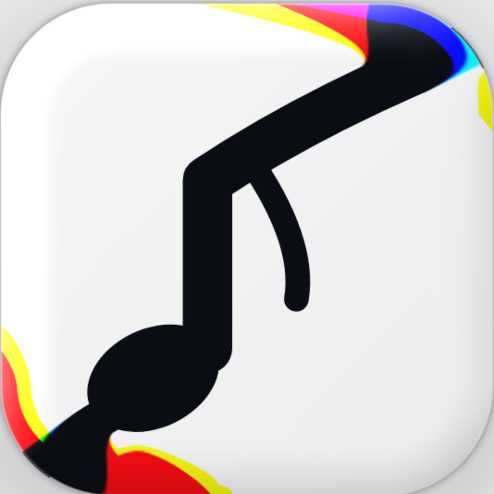

**Fady. The Only Sherlock House!**

# GlassLookStore debug log

Each error: date and version, what failed, real cause and proof, fix (files), test, rating, status.

## 2026-11-05 · preview builds 10 to 16 (before 0.1.0 code)

### 1. The lens landed off centre after release
- **What failed:** owner's screenshot: the pill sat about 7 pt right of Logs after a drag.
- **Real cause and proof:** tab centres were measured on the pressed bar (3.5 % bigger) and the bar shrank back on release; 3.5 tabs × 3.5 % ≈ 7.8 pt, matching the 7.3 pt measured on the screenshot.
- **Fix:** finger, spring and target use the bar at rest; the grow only scales the drawing. In the app: `BarLayout` in `Components/GlassTabBar.swift` (`center`, `nearest`, `clamp`).
- **Test:** touch drags on an emulated iPhone landed exactly on each centre; app check `bar.layout`, UI test `testDragLens`.
- **Rating:** 9/10, proof by measurement, confidence 90 %. **Status:** fixed in the preview, carried into 0.1.0 (not compiled yet).

### 2. Card A looked pixelated
- **What failed:** owner: "Why liquid slab is pixelated".
- **Real cause and proof:** the frost blur ran over the card's own text (a single ring of 8 samples printed each letter several times); a 3x zoomed render showed doubled letters. Also the page drew at 2x on a 3x screen.
- **Fix:** text above the glass, frost only on what is behind; 16 sample frost; full resolution. In the app: `Components/GlassCard.swift` draws the content above `CardSurface`.
- **Test:** zoomed render after the fix: crisp text.
- **Rating:** 9/10, proof by render, confidence 95 %. **Status:** fixed.

### 3. End pills ran into the bar's rounded ends
- **What failed:** owner: "Align the bubble" (Settings pill touched the bar end).
- **Real cause and proof:** five equal slices plus a pill 8 pt wider than a slice; IMG7 measured: pill 84 pt, 4.3 pt inside the end, tab spacing 76.5 pt.
- **Fix:** `BarLayout` inset 4.3 pt, pill = spacing + 7.5 pt.
- **Test:** emulated iPhone: Settings pill fully inside, centred; check `bar.layout` asserts both end gaps equal 4.3 pt.
- **Rating:** 9/10, proof by measurement, confidence 90 %. **Status:** fixed.

## 2026-11-05 · 0.1.0 (build 1), first Codemagic run

### 4. The build stopped at the shaders
- **What failed:** Codemagic 6aeccc8561581f3ab554b94c, step "Build the app, unsigned": `cannot execute tool 'metal' due to missing Metal Toolchain`.
- **Real cause and proof:** Xcode 26.6 on the Codemagic Mac ships without the Metal Toolchain; the log names it and the only failed commands are `CompileMetalFile` for GlassLens.metal and LiquidWave.metal.
- **Fix:** `codemagic.yaml` workflow `glasslookstore-ipa`: new step `xcodebuild -downloadComponent MetalToolchain` before the build.
- **Test:** the rebuild under the same Go.
- **Rating:** 9/10, proof by build log, confidence 90 %. **Status:** fixed, waiting for the rebuild.

## 2026-11-05 · 0.1.0 (build 1), second Codemagic run (6aeccdd6a61e555a437c69c6)

### 5. Two UI tests could not find rows in Settings
- **What failed:** `testBuiltInSelfTestPasses` (line 91) and `testVersionIsShownInSettings` (line 108): row not found. The app compiled (1 warning) and 3 of 5 UI tests passed (drag lens, light and dark screenshots).
- **Real cause and proof:** Settings is a Form that loads rows only when they scroll into view; the Settings screenshot ends at the AI glass section, above Tools and About.
- **Fix:** the UI tests swipe up until the row exists (`scrollTo`, up to 8 swipes). Also: `UIRequiresFullScreen` (the one warning: a portrait-only app must say it needs full screen) and the glass background behind Settings (it was plain white).
- **Test:** the next run under the same Go.
- **Rating:** 9/10, proof by screenshot and test log, confidence 85 %. **Status:** fixed, waiting for the rebuild.

## 2026-11-05 · 0.1.0 (build 1), third Codemagic run (6aeccfb49144d826218363a9)

### 6. The 🧪 Test result label was not found
- **What failed:** 4 of 5 UI tests passed; `testBuiltInSelfTestPasses` stopped at line 108 (`test.state` not found), before the 🧪 Test result was read.
- **Real cause and proof:** the label was inside a ProgressView, which iOS merges into one progress element, so its identifier is not exposed; line 108 is `state.waitForExistence`.
- **Fix:** the result is its own Text with the identifier (`Views/SelfTestView.swift`). Also: `UIRequiresFullScreen` is deprecated in iOS 26 (new warning), replaced by iPad orientations in `project.yml`; the UI test class is `@MainActor` (Swift 6 notes in the test build).
- **Test:** the next run under the same Go.
- **Rating:** 8/10, proof by test log, confidence 80 %. **Status:** fixed, waiting for the rebuild.

## 2026-11-05 · 0.1.0 (build 1), fourth Codemagic run (6aecd2799a329398cbfaab41)

### 7. The app closed while the 🧪 Test ran
- **What failed:** 0 warnings now; 4 of 5 UI tests passed. After tapping Run, nothing on screen could be found ("Unable to monitor animations", then "Restarting after unexpected exit, crash, or test timeout", test.log line 1327).
- **Likely cause (not proven yet):** check `provider.manual` makes a temporary SwiftData container, and `ManualProvider` kept only `container.mainContext`, so the container could be released while its context was used.
- **Fix:** `Data/ManualProvider.swift` keeps the container (`let container`). For proof: the workflow now copies the simulator's crash reports (`dist/CrashReports`) and the UI test asserts the app is still running after Run.
- **Test:** the next run under the same Go.
- **Rating:** 6/10, proof by code reading only, confidence 60 %. **Status:** fix written, crash report collection added.

### 8. Codemagic stopped: billing
- **What failed:** the 5th Codemagic run was refused: `BILLING_NOT_ENABLED`.
- **Fix (owner: "Build in github"):** new GitHub Actions workflow `.github/workflows/glasslookstore-ipa.yml` (macos-15, newest Xcode 26, the same steps as Codemagic, .ipa and screenshots kept as artifacts). Codemagic workflow kept.
- **Status:** GitHub run 42101480077 failed in 2 s with no runner (runner id 0, no log, empty check output), like this repo's two earlier GitHub Mac runs (41128610884, 41148469027, Oct 30 and 31). Likely cause: GitHub Actions will not give Mac minutes to this private repo (billing or spending limit); GitHub did not say so, so not proven. Owner: Codemagic billing refreshes with the new month.

### 9. Type checker timeout on GitHub (Xcode 26.3)
- **What failed:** GitHub run 42103384596 (GlassLookStore-221B): `SelfTestView.swift:24: the compiler is unable to type-check this expression in reasonable time`. Codemagic (Xcode 26.6) compiled the same code.
- **Real cause and proof:** one array literal of 17 trailing closures in `FeatureChecks.all`; the build log names line 24, the start of that literal; the older compiler gave up.
- **Fix:** `Views/SelfTestView.swift` builds the list with one `c.append(...)` per check (same 17 checks, same order).
- **Test:** the next GitHub run under the same Go.
- **Rating:** 9/10, proof by build log, confidence 90 %. **Status:** fixed, waiting for the rerun.
