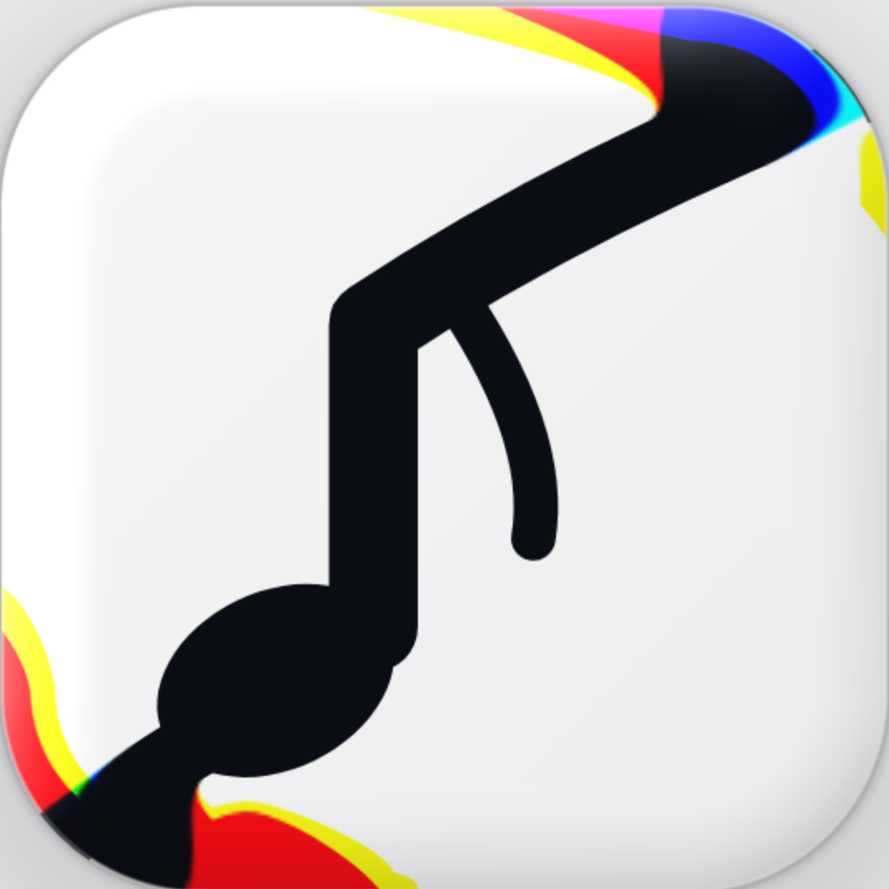

**Fady. The Only Sherlock House!**

# GlassLookStore

A live counter dashboard for coding, in a thick, clear Liquid Glass look copied from 7 reference pictures (IMG1 to IMG7). Native SwiftUI for iOS 26, iPhone only, portrait.

**Version 0.1.0 (build 1)** · installer: `GlassLookStore-v0.1.0.ipa`

## What it does

- **Live tab:** the session timer HH:MM in huge ultra-thin numerals under a slow liquid wave, date, project and status, a battery-style "usage left" bar and your signature; six live tiles (tokens today, time until the limit resets, commits, lines added and removed, last build, streak) and a 7 day sparkline. Every number rolls when it changes.
- **Tab bar (Walmart look, IMG6 and IMG7):** a floating capsule with a grey pill under the chosen tab. Press or drag and the pill turns into a clear glass lens that magnifies the tabs 1.4x with IMG1 colour rims, follows your finger, stretches with your speed and springs to the nearest tab (response 0.35, damping 0.7). Labels are mirrored in the bottom bevel (IMG3).
- **Projects, Stats, Logs:** project cards with version and a progress ring; weekly and monthly Swift Charts; a monospaced event timeline with swipe to delete.
- **Settings:** theme (System, Light, Dark), haptics, wave, accent colour, data source, signature, look switches, icon packs, 🤖 AI glass, 🧪 Test, 📜 Updates Log, version and build.
- **Glass:** native Liquid Glass with the GlassLens Metal shader on top (refraction rising toward the rim, red and blue fringes, white streak, inner stroke) and the LiquidWave shader. Apple AI on the iPhone decides colours, frost and blur.
- **Data:** Mock (default, moves every second), Manual (SwiftData) or GitHub (commits and lines today; the token stays in the Keychain).
- **Widgets:** Home Screen (small, medium), Lock Screen (circular, rectangular, inline), Live Activity and Dynamic Island.
- **Accessibility:** Reduce Transparency (opaque cards), Reduce Motion (no wave, stretch or zoom), Dynamic Type, VoiceOver labels on every tab and counter.

## Install on your iPhone

1. Download `GlassLookStore-v0.1.0.ipa` from the chat (Claude attaches it after each build).
2. Open SideStore, AltStore or Sideloadly on your computer or iPhone.
3. Add the `.ipa` as a new app and let the tool sign it with your Apple ID.
4. On the iPhone, open Settings › General › VPN & Device Management and trust your Apple ID, if asked.
5. Open GlassLookStore, then Settings › 🧪 Test › Run, and paste 📋 Copy for Claude in the chat.

The unsigned `.ipa` carries an ad-hoc signature with the App Group so the widget can read the session; the sideloading tool re-signs it.

## Building

- **Codemagic (how Claude builds it):** workflow `glasslookstore-ipa` in the repo's `codemagic.yaml`. It runs XcodeGen, an unsigned Release build, the UI tests on the iPhone 17 Pro simulator (light and dark screenshots, drag lens tests, the built-in 🧪 Test) and packs the `.ipa` plus a screenshots zip. A build starts only after the owner types Go.
- **On a Mac:** `Scripts/BuildIpa.sh unsigned` or `TEAM_ID=… Scripts/BuildIpa.sh signed` writes `Build/GlassLookStore-vX.Y.Z.ipa`.

## Files

```
GlassLookStore/
  App/GlassLookStore.swift
  Views/LiveView, ProjectsView, StatsView, LogsView, SettingsView, SelfTestView, UpdatesLogView
  Components/GlassTabBar, GlassLensDroplet, GlassCard, HeroCounterCard, StatTile, UsageBar, SparklineCard
  Shaders/GlassLens.metal, LiquidWave.metal
  Data/CounterProvider, MockProvider, ManualProvider, GitHubProvider, KeychainStore
  Theme/GlassTheme, Haptics
  Widgets/GlassLookStoreWidget, GlassLookStoreLiveActivity
  Resources/Assets.xcassets
GlassLookStoreUITests/GlassLookStoreUITests.swift
project.yml · CHANGELOG.md · DEBUGLOG.md · README.md · Scripts/BuildIpa.sh
```

## Credits

Icon packs: Phosphor, Remix Icon, Open Symbols and Lucide, MingCute, Ionicons, Fluent, Heroicons, Iconoir, Material Symbols, Hugeicons, Fluent Emoji, Flat Color Icons, Solar (each credit is in Settings › Icon pack). Visual style copied from reference pictures only; no brand logos, wordmarks or icons from the reference apps.

Rules for this project: [Readme-Updates master](https://github.com/farahotaelgn/Readme-Updates/blob/main/README.md) and the repo's `CLAUDE.md`.
